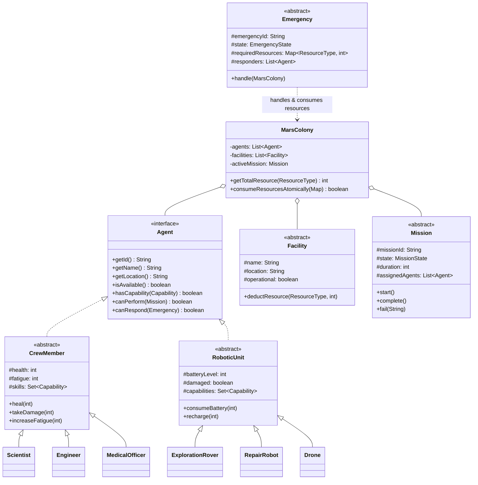

# 🚀 MARS-OPS: Mars Colony Management & Simulation System

[](https://www.oracle.com/java/)
[](#system-architecture)
[](#)

A modular, Object-Oriented Mars colony simulation platform designed in Java. **MARS-OPS** models the operations of a Martian outpost, managing specialized crew members, robotic units, colony infrastructure, resource lifecycles, exploration missions, and crisis emergencies under harsh environmental conditions.

---

## 📌 Table of Contents
- [Overview](#overview)
- [System Architecture](#system-architecture)
- [Packages & Modules](#packages--modules)
  - [1. Core (`marsops.core`)](#1-core-marsopscore)
  - [2. Agents (`marsops.agents`)](#2-agents-marsopsagents)
  - [3. Facilities (`marsops.facilities`)](#3-facilities-marsopsfacilities)
  - [4. Missions (`marsops.missions`)](#4-missions-marsopsmissions)
  - [5. Emergencies (`marsops.emergencies`)](#5-emergencies-marsopsemergencies)
- [Team Ownership & Collaboration](#team-ownership--collaboration)
- [Git Workflow](#git-workflow)
- [Build & Execution](#build--execution)
- [Design Diagrams](#design-diagrams)

---

## 🌌 Overview

Establishing a sustainable human presence on Mars requires autonomous coordination between humans, robotics, life-support facilities, and mission control. **MARS-OPS** simulates:
- **Agent Coordination**: Assigning tasks to human specialists (`CrewMember`) and autonomous machinery (`RoboticUnit`).
- **Resource Management**: Tracking consumables like Oxygen, Water, Food, Fuel, Battery Power, and Medical Supplies.
- **Mission Execution**: Planning and executing surface exploration, research experiments, infrastructure repair, and rescue missions.
- **Crisis Response**: Reacting to sudden environmental and colony hazards (e.g., Dust Storms, Oxygen Leaks, Habitat Fires, Equipment Breakdowns) through atomic resource consumption and responder dispatch.

---

## 🏛 System Architecture

The project follows clean Object-Oriented Design principles:
- **Abstraction & Polymorphism**: Abstract classes (`Agent`, `CrewMember`, `RoboticUnit`, `Facility`, `Mission`, `Emergency`) defining standardized behaviors for specialized implementations.
- **Encapsulation**: State protection through strict property encapsulation and validation.
- **Decoupling**: Package segregation allowing concurrent development across multiple team members.



---

## 📦 Packages & Modules

### 1. Core (`marsops.core`)
The backbone interfaces, colony state, and enumeration models:
- **`Agent`**: Base interface contract for any unit capable of acting in the colony.
- **`MarsColony`**: Central hub tracking all registered agents, facilities, resources, and the active mission.
- **`Simulation` & `Main`**: Entry point driving time-steps, tick cycles, and environment conditions.
- **Enums**:
  - `Capability`: `SCIENTIFIC_RESEARCH`, `ENGINEERING_REPAIR`, `MEDICAL_CARE`, `SURFACE_EXPLORATION`, `AERIAL_RECON`, `HEAVY_TRANSPORT`.
  - `ResourceType`: `OXYGEN`, `WATER`, `FOOD`, `FUEL`, `BATTERY_POWER`, `MEDICAL_SUPPLIES`, `SPARE_PARTS`.
  - `MissionState`: `ASSIGNED`, `IN_PROGRESS`, `COMPLETED`, `FAILED`.
  - `EmergencyState`: `TRIGGERED`, `RESOLVED`, `UNRESOLVED`.
  - `EnvironmentCondition`: `NORMAL`, `DUST_STORM`, `COMMUNICATION_DISRUPTION`.

---

### 2. Agents (`marsops.agents`)
Subdivided into Human Crew Members and Autonomous Robotic Units:
- **Human Crew (`CrewMember`)**:
  - `Scientist`: Conducts specialized research, executes scientific missions.
  - `Engineer`: Maintains infrastructure, executes repair operations and emergency fixes.
  - `MedicalOfficer`: Provides medical treatment, treats crew injuries during emergencies.
- **Robotic Units (`RoboticUnit`)**:
  - `ExplorationRover`: Surface traverser equipped for terrain surveying and transport.
  - `RepairRobot`: Automated heavy-repair unit dispatched to dangerous breakdown zones.
  - `Drone`: Fast aerial reconnaissance unit capable of scouting and surveillance.

---

### 3. Facilities (`marsops.facilities`)
Infrastructure units that house colonists, produce life essentials, or store gear:
- **`Habitat`**: Quarters for crew recovery and rest.
- **`LifeSupportSystem`**: Regulates atmospheric oxygen and potable water.
- **`Laboratory`**: Environment for scientific research and sample analysis.
- **`PowerStation`**: Generates and supplies battery power to facilities and robots.
- **`StorageFacility`**: Secure depot managing resource inventories and spare parts.
- **`CommunicationStation`**: Deep-space and local telemetry hub.
- **`Equipment`**: Tools and hardware deployed across facilities.

---

### 4. Missions (`marsops.missions`)
Task allocations dispatched by Colony Control:
- **`ExplorationMission`**: Mapping uncharted Martian territories.
- **`ResearchMission`**: Field experiments, soil analysis, and astrobiological studies.
- **`RepairMission`**: Maintenance and restoration of malfunctioning colony modules.
- **`RescueMission`**: Evacuation and emergency retrieval of stranded agents or damaged units.

---

### 5. Emergencies (`marsops.emergencies`)
Critical incidents requiring immediate responder mobilization and resource allocation:
- **`FireEmergency`**: Threatens habitat integrity; requires engineering containment and water.
- **`MedicalEmergency`**: Crew health jeopardy; requires Medical Officers and medical kits.
- **`OxygenLeakEmergency`**: Breached seal or life-support failure; demands rapid spare parts and sealing.
- **`RoverBreakdownEmergency`**: Stranded mechanical unit needing field engineers or repair robots.

---

## 👥 Team Ownership & Collaboration

Each team member has dedicated ownership of specific packages to prevent merge conflicts:

| Person | Package / Scope | Key Responsibilities |
|---|---|---|
| **Person 1** | `marsops.facilities` | `Facility`, `Habitat`, `LifeSupportSystem`, `Laboratory`, `StorageFacility`, `PowerStation`, `CommunicationStation`, `Equipment` |
| **Person 2** | `marsops.agents` | `CrewMember`, `Scientist`, `Engineer`, `MedicalOfficer`, `RoboticUnit`, `ExplorationRover`, `RepairRobot`, `Drone` |
| **Person 3** | `marsops.missions` + `core` | `Mission` and subtypes (`Exploration`, `Research`, `Repair`, `Rescue`), `MarsColony`, `Simulation` |
| **Person 4** | `marsops.emergencies` + `core` | `Emergency` and subtypes (`Fire`, `Medical`, `OxygenLeak`, `RoverBreakdown`), `Main` execution |

> [!IMPORTANT]
> **Shared & Frozen Enums**: Types in `core/` (`Capability`, `ResourceType`, `EmergencyState`, `EnvironmentCondition`, `MissionState`, and `Agent`) are frozen. Do not alter their signatures without team-wide consensus.

---

## 🌿 Git Workflow

To maintain clean repository hygiene, team members work on isolated feature branches:

```bash
# 1. Switch to a new branch for your module
git checkout -b personX-module-name

# 2. Stage and commit your assigned package files
git add src/marsops/module-name
git commit -m "feat(module): implement module functionality"

# 3. Push your branch to the remote repository
git push -u origin personX-module-name

# 4. Open a Pull Request into main for review
```

---

## ⚙️ Build & Execution

### Prerequisites
- **JDK 17** or higher
- Standard terminal (PowerShell, Bash, or Command Prompt)

### Compilation

**Linux / macOS (Bash):**
```bash
mkdir -p out
javac -d out $(find src -name "*.java")
```

**Windows (PowerShell):**
```powershell
New-Item -ItemType Directory -Force -Path out
Get-ChildItem -Path src -Recurse -Filter *.java | ForEach-Object { $_.FullName } | Out-File -Encoding ascii sources.txt
javac -d out @sources.txt
Remove-Item sources.txt
```

### Running the Simulation
```bash
java -cp out marsops.core.Main
```

---

## 📊 Design Diagrams

The `Diagrams/` folder contains comprehensive architectural diagrams (viewable with [draw.io](https://app.diagrams.net/)):
- `MARS-OPS-UML-1.drawio`: Complete class diagram.
- `MARS-OPS-Object-Diagram.drawio`: Runtime object snapshot.
- `MARS-OPS-State-Machine-1.drawio`: Life-cycle states for missions and emergencies.
- `Sequence Mission A.drawio`: Sequence flow for mission dispatch.
- `Sequence Oxygen Leak B.drawio`: Sequence flow for emergency response.
- `Sequence Dust Storm C.drawio`: Environmental disturbance handling.
- `Use Case Diagram.drawio`: System actor use cases.
